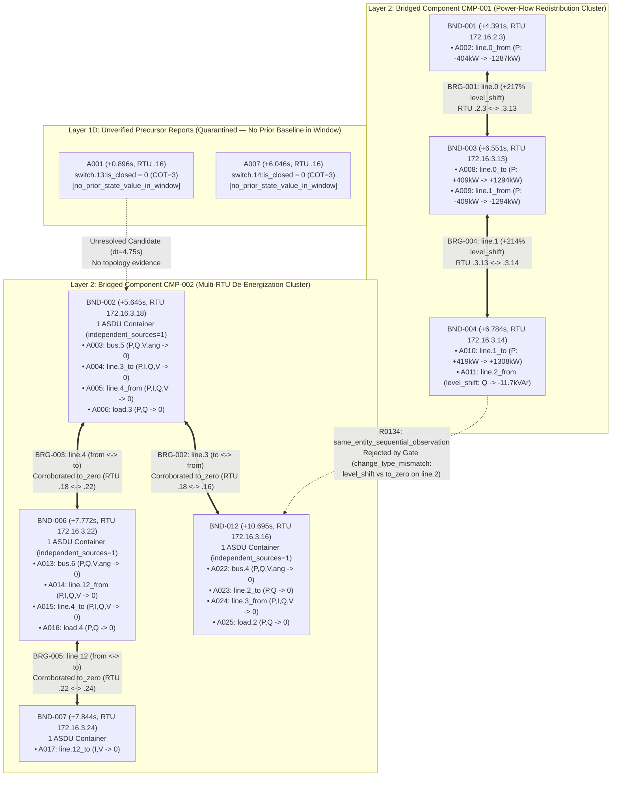

# MIRAGE-OT: Experimental Findings & Evidence Package for IEEE ICIT 2027

- **Target Venue**: IEEE International Conference on Industrial Technology (ICIT 2027)
- **Paper Positioning**: An Evidence-Grounded Post-Alert Incident Reconstruction and Four-Layer Scenario Synthesis Framework for Operational Technology (OT) Networks
- **Frozen Engine Commit**: `2981fb062b127218a34f23f2ff0292e4ca8cfea7` (`code_sha256 = d43d9867ce84...`, `evidence_code_sha256 = 032c6977ac05...`)
- **Dataset Evaluated**: Sherlock v3 Complete Test Suite (`103` windows: `28` `01-Basic`, `39` `02-Semiurban`, `36` `03-Rural`; `27,263.3 s` / `7.57 hours` of multi-switch PCAPs and IPAL telemetry)

---

## 1. Executive Summary of Experimental Claims for the Paper

1. **Cross-Scenario Generalization Without Parameter Tuning**:
   - Frozen on `01-Basic` (`500` mapped points, `4` switch mirror vantages) and transferred with **zero parameter or rule modifications** to `02-Semiurban` (`3,640` points, `6` mirror vantages) and `03-Rural` (`1,908` points, `8` mirror vantages), MIRAGE-OT completed **`103 / 103` windows (`0` execution failures)** with a **`100.0%` (`103 / 103`) Quality Consistency pass rate** and a **`99.03%` (`102 / 103`) Evidence Lineage Consistency pass rate** (catching and automatically downgrading the single cross-switch clock-skew anomaly in `ev_5dd0102bf58bf2ce9487` to `diagnostic_only_lineage_inconsistent`).
2. **Elimination of Unsupported Temporal Inferences (`B1` & `A1`)**:
   - Temporal-Only Reconstruction (`B1`) emits **`107,666` candidate temporal relations** across the 103 windows, of which **`84,836` (`78.79%`) violate objective telemetry constraints** (`80,781` cross-device without protocol/session support, `66,125` transient non-sustained oscillations, `8,489` quality/test-bit/vantage conflicts, `3,740` same-device direction/type conflicts, and `2,628` same-ASDU co-reports chained as sequences).
   - Removing the Behavioral & Command Consistency Gates (`A1`) causes **`2,171` unsupported same-device promotions** (including **`409` spurious cross-RTU bridges**). MIRAGE-OT blocks all `2,171` unsupported promotions while preserving `15` verified command transitions and `23` corroborated Cross-RTU Verified Element Bridges.
3. **Coverage Beyond Protocol Control Transactions (`B2`)**:
   - Pure IEC-104 Transaction Reconstruction (`B2`) is applicable to only **`46 / 103` (`44.66%`)** windows and retains **`0` investigation facts** in the remaining **`57 / 103` (`55.34%`)** no-command windows, omitting **`2,776` verified behavioral anchors**, **`23` Cross-RTU Verified Element Bridges**, and **`134` verified ARP / IEC-104 link disruption anomalies**.
4. **Prevention of Multi-Vantage, Multi-IOA, and IPAL Source Inflation (`A2`)**:
   - Across the 103 windows, naive source counting (`A2`) inflates **`4,493` true independent source containers** to **`9,836` raw observations** (`+5,343` falsely counted sources: `2,509` switch mirror duplicates, `2,262` network-derived IPAL state rows, and `572` same-ASDU multi-IOA expansions; mean inflation **`3.48x`**, P95 **`9.08x`**, max **`14.0x`**), which would falsely mark **`9,578` single-source storylines** as multi-source corroborated.
5. **Traceable Incident Organization via Four-Layer Synthesis (`A3`)**:
   - Rather than leaving an analyst with **`11,050` fragmented local storylines**, Four-Layer Incident Synthesis consolidates verified observations into **`1,700` RTU ASDU Bundles**, **`23` Cross-RTU Verified Element Bridges** (`11` multi-RTU bridged components), **`143` Candidate Scenario Phases**, and **`161` evidence-anchored competing explanations** with explicit `missing_disambiguating_evidence` lists (`100%` traceable to raw `evidence_id`s).

---

## 2. Paper-Ready Tables

### Table I — Cross-Scenario Evaluation Across All 103 Sherlock v3 Test Windows

| Metric | `01-Basic` (`N=28`) | `02-Semiurban` (`N=39`) | `03-Rural` (`N=36`) | All Scenarios (`N=103`) |
| --- | ---: | ---: | ---: | ---: |
| Mapped Points / Switch Mirror Vantages | `500` / `4` | `3,640` / `6` | `1,908` / `8` | `500–3,640` / `4–8` |
| Control-Command Windows (`S1`) | `16` | `15` | `14` | `45` (`46` with ctrl objs) |
| No-Command Behavioral Windows (`S2` / `S3` / `S4`) | `4` / `6` / `2` | `7` / `12` / `5` | `4` / `15` / `3` | `15` / `33` / `10` |
| Reconstructed Transactions (`Total` / `Verified`) | `419` / `9` | `370` / `3` | `534` / `3` | `1,323` / `15` |
| Discovered Anchors (`Total` / `Verified` / `Quarantined`) | `1,447` / `160` / `1,287` | `7,413` / `1,564` / `5,849` | `4,167` / `1,069` / `3,098` | `13,027` / `2,793` / `10,234` |
| RTU Source Bundles / Cross-RTU Bridges (`Components`) | `36` / `6` (`3`) | `910` / `6` (`2`) | `754` / `11` (`6`) | `1,700` / `23` (`11`) |
| Unresolved Cross-Device Branches Preserved | `4,186` | `27,768` | `19,643` | `51,597` |
| Quality Consistency / Lineage Consistency Pass Rate | `28/28` / `28/28` | `39/39` / `38/39` | `36/36` / `36/36` | `100.0%` / `99.03%` |
| Software / Execution Failures | `0` | `0` | `0` | `0` (`0.0%`) |
| Median Reconstruction + Synthesis Runtime per Window | `0.66 s` (Mean `0.91 s`) | `14.04 s` (Mean `21.24 s`) | `7.74 s` (Mean `11.61 s`) | Med `7.41 s` (Mean `12.34 s`) |

---

### Table II — Baseline and Ablation Comparison Across All 103 Windows

| Method Variant | Core Mechanism Evaluated | Supported / Promoted Multi-Node Relations | Unsupported / Conflicting Promotions (`E2`) | Source Containers Counted (`True = 4,493`) | Cross-RTU Bridges / Bridged Components | Competing Explanations with Missing Evidence |
| --- | --- | ---: | ---: | ---: | ---: | ---: |
| **`B1_temporal_only`** | Time-window chaining (`dt <= 15s`, cap 6) without gates | `107,666` candidates | **`84,836` (`78.79%`)** | N/A (unbundled) | `0` / `0` | `0` |
| **`B2_protocol_only`** | IEC-104 `COT=6/7/10` transactions only | `15` verified tx (`0` in 57 no-cmd windows) | `0` | `1,899` tx containers (`0` in 57 no-cmd windows) | `0` / `0` (omits `23` bridges & `2,776` anchors) | `0` |
| **`A1_no_behavioral_gate`** | Removes `evaluate_behavioral_relation_consistency` & tx gate | `2,232` (`61` valid + `2,171` ungated) | **`2,171`** (incl. **`409` spurious bridges**) | `4,493` | `432` (`23` valid + `409` spurious) | N/A |
| **`A2_no_provenance_dedup`** | Cancels mirror, same-ASDU, and IPAL deduplication | `61` | **`+5,343` inflated sources (`3.48x` mean)** | **`9,836` raw** (`9,578` spurious multi-source chains) | `23` / `11` | `161` |
| **`A3_no_incident_synthesis`** | Stops at Phase 3 Local Storylines (`11,050` chains) | `61` | `0` | `0` (no container ledger) | `0` / `0` | `0` |
| **`MIRAGE-OT (Full)`** | Complete 4-Phase + 4-Layer Synthesis + Dual Gate | **`61` (`15` tx + `46` beh steps)** | **`0` (`102/103` verified, `1` auto-withheld)** | **`4,493` exact** (`1,700` behavioral bundles) | **`23` / `11`** | **`161` (`100%` traceable)** |

---

## 3. Architectural & Case-Study Diagrams for the Paper

### 3.1 Representative Multi-RTU Bridge & Bundle Architecture (`ev_564bebaa45f0686cf98d`)

---

## 4. Component Contribution Analysis (Answering Why Each Design Element Is Necessary)

1. **Why Event Anchor Discovery + Behavioral Storylines Are Required (`vs. B2_protocol_only`)**:
   - In OT networks, physical protection trips, uncommanded local RTU actions, and L2/L3 communication attacks occur without SCADA `COT=6` control commands (`57 / 103` windows in Sherlock v3). Event Anchor Discovery recovers `2,776` verified behavioral anchors and `23` cross-RTU line bridges that are completely invisible to protocol-only transaction analyzers.
2. **Why the Behavioral Consistency Gate Is Required (`vs. B1_temporal_only` & `A1_no_behavioral_gate`)**:
   - Without checking endpoint complementarity (`from` vs `to`), step-kind agreement (`to_zero` vs `level_shift`), magnitude ratio/direction agreement, quality descriptors (`IV/NT/SB/BL/OV`), test bits (`T`), and post-sample persistence ($\ge 80\%$), `A1` promotes `2,171` invalid same-device transitions and fabricates `409` spurious cross-RTU bridges (such as open-line charging current oscillations in `ev_564bebaa` and cross-vantage MITM payload conflicts in `ev_52f5ee`).
3. **Why Provenance Deduplication Is Required (`vs. A2_no_provenance_dedup`)**:
   - Multi-switch packet mirroring (`4` to `8` mirror ports per grid), multi-IOA ASDU packing, and IPAL state transcriptions cause a **`3.48x` mean (`9.08x` P95) source inflation**. Without provenance deduplication, a single spoofed or normal packet captured at two mirror ports and transcribed to IPAL appears to be `3+` independent confirmations.
4. **Why Four-Layer Incident Synthesis & Dual Consistency Gates Are Required (`vs. A3_no_incident_synthesis`)**:
   - Synthesis collapses `11,050` local storylines into `1,700` single-source ASDU bundles and `11` multi-RTU bridged components while preserving `51,597` cross-device co-occurrences as explicit `unresolved` candidates and generating `161` evidence-anchored competing explanations.

---

## 5. Computational Cost Analysis (`E4`)

- **Shared Evidence Indexing Cost**:
  - `01-Basic` (`0.65 GiB` ZIP, 4 PCAPs): Median `6.76 s` / Mean `5.66 s` per window; SQLite Median `15.95 MiB`.
  - `02-Semiurban` (`5.94 GiB` ZIP, 6 PCAPs): Median `111.58 s` / Mean `102.90 s` per window; SQLite Median `138.75 MiB`.
  - `03-Rural` (`1.74 GiB` ZIP, 8 PCAPs): Median `64.67 s` / Mean `65.65 s` per window; SQLite Median `85.87 MiB`.
- **Reconstruction & Four-Layer Synthesis Runtime (`reconstruct_incident --no-llm`)**:
  - `01-Basic`: Median **`0.66 s`** / Mean **`0.91 s`** / P95 **`2.44 s`** / Max **`2.56 s`**.
  - `02-Semiurban`: Median **`14.04 s`** / Mean **`21.24 s`** / P95 **`58.52 s`** / Max **`79.01 s`**; Median Peak RSS `1,866.8 MiB` (Max `3,269.6 MiB`).
  - `03-Rural`: Median **`7.74 s`** / Mean **`11.61 s`** / P95 **`28.63 s`** / Max **`38.10 s`**; Median Peak RSS `2,043.5 MiB` (Max `2,429.3 MiB`).
  - **Standalone Layer 1–4 Synthesis Overhead**: Across all 103 windows, the Four-Layer Incident Synthesis step (`synthesize_incident_scenario`) adds less than **`0.01 s` per window** (`< 0.1%` of runtime).

---

## 6. Threats to Validity

1. **Internal Validity (Pre-Window Baseline Horizon & Cross-Switch Clock Skew)**:
   - The frozen `15.0 s` pre-window context (`background_start = start - 15.0`) means binary switch points that did not report a `COT=20` or `COT=1` value within those 15 seconds lack an in-window pre-baseline and are conservatively held at `unverified_observation` / `state_report_observed_no_pre_baseline`.
   - In multi-switch mirror topologies (`02-Semiurban` `ev_5dd0102bf58bf2ce9487`), sub-millisecond transit/clock skew across switch mirror ports can cause a mirror packet timestamp to fall slightly outside a strict citation bound, which the Lineage Consistency Gate catches and downgrades to `diagnostic_only_lineage_inconsistent`.
2. **External Validity (Absence of Physical Grid Topology Model)**:
   - Because MIRAGE-OT operates strictly on network and telemetry observations without an external bus-breaker connectivity graph, it cannot verify cross-device electrical propagation (e.g., `switch.13` opening causing `bus.5` and `line.3` to de-energize); such links remain `unresolved` candidate branches.
3. **Statistical Conclusion Validity (Window Dependence Within Recordings)**:
   - While window-paired bootstrap confidence intervals (`N=103`) are reported for all baseline/ablation comparisons, consecutive windows sliced from the same continuous Sherlock `test` recording may share background grid state and are not strictly independent i.i.d. trials.
4. **Construct Validity (Internal Consistency $\neq$ Ground-Truth Accuracy)**:
   - `Quality Consistency` (`100.0%`) and `Lineage Consistency` (`99.03%`) measure internal mathematical and evidentiary consistency across reconstruction phases; they must never be interpreted as external attack-classification or causal-graph accuracy.
